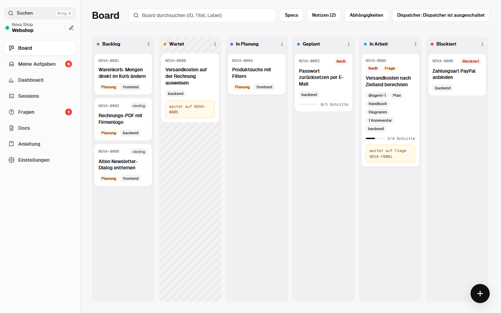
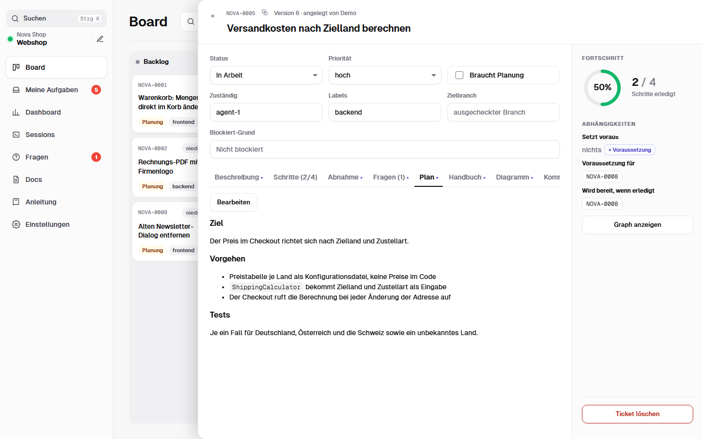
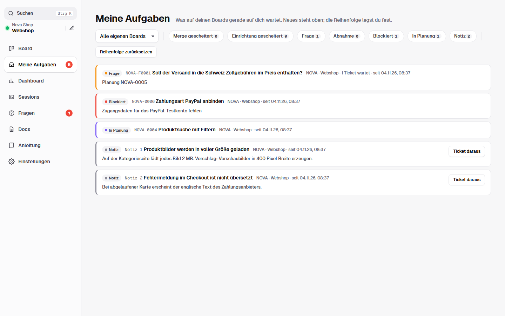
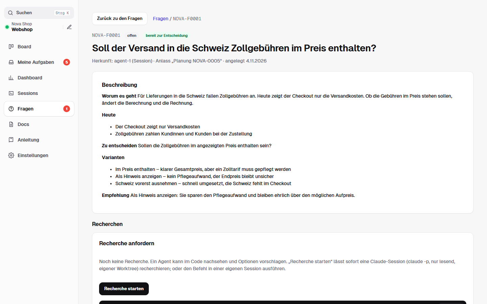
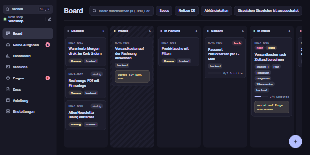
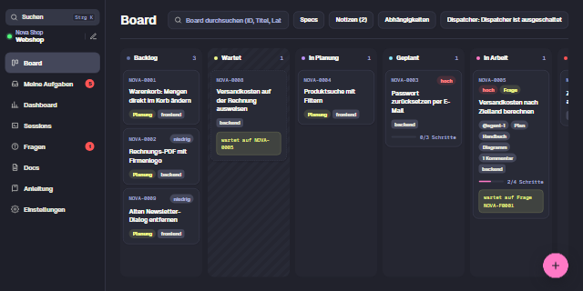
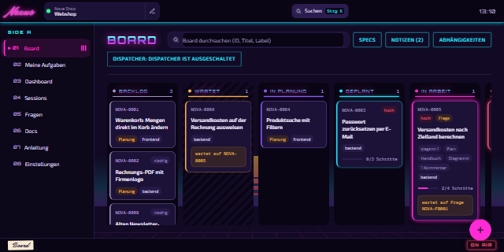
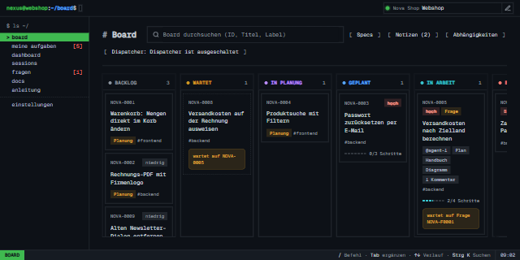
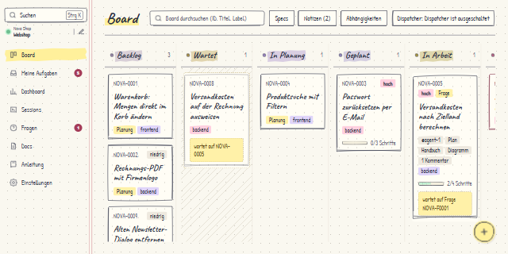
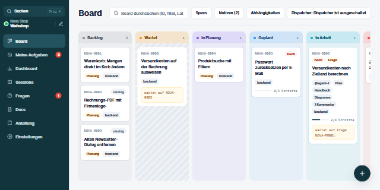

<div align="center">

<picture>
  <source media="(prefers-color-scheme: dark)" srcset="assets/brand/nullradix-logo-dark.svg">
  
</picture>

<h1>HIER BEI HANDELT ES SICH UM EIN REWORK EINES BESTEHENDEN HARNESS. DER GROßTEIL DES HARNESS IST NOCH DER ALTE<h1>
<h3>Die lokale Werkbank für viele Claude-Code-Sessions gleichzeitig</h3>

Kanban-Board mit Tickets, Fragen und Notizen · konfliktfreie Parallelarbeit in Branches und Worktrees · ein Dispatcher, der geplante Tickets selbst umsetzen lässt

[](https://github.com/BenjaminBiber/Nexus)
[](LICENSE)

[](https://claude.com/claude-code)


[**Einrichten**](#einrichten-einmal-pro-rechner) · [**Verwenden**](#verwenden) · [**Dispatcher**](#dispatcher-tickets-automatisch-umsetzen-lassen) · [**Telegram-Bot**](#telegram-bot) · [**Entwicklung**](#entwicklung-an-nullradix) · [**Upstream**](https://github.com/BenjaminBiber/Nexus)

</div>

<br>



## Inhalt

- [Überblick](#überblick)
- [Einrichten (einmal pro Rechner)](#einrichten-einmal-pro-rechner)
- [Aktualisieren](#aktualisieren)
- [Umstieg von Nexus oder AI Harness](#umstieg-von-nexus-oder-ai-harness)
- [Verwenden](#verwenden)
  - [Projekt einrichten](#projekt-einrichten) · [Die Oberfläche](#die-oberfläche) · [Ablauf](#ablauf) · [Hinweise](#hinweise) · [Sicherung](#sicherung)
- [Board-Datenbank](#board-datenbank)
  - [SQL Server (Team)](#variante-a-sql-server-team) · [SQLite (Einzelplatz)](#variante-b-sqlite-einzelplatz)
- [Dispatcher](#dispatcher-tickets-automatisch-umsetzen-lassen)
  - [Einstellungen und Befehle](#einstellungen-und-befehle) · [Recherchen zu Fragen](#recherchen-zu-fragen) · [Planen am Ticket](#planen-am-ticket) · [Mehrere Claude-Accounts](#mehrere-claude-accounts) · [Zustand und Protokolle](#zustand-und-protokolle)
- [Telegram-Bot](#telegram-bot)
  - [Einrichten](#einrichten) · [Befehle](#befehle) · [Freigaben und Meldungen](#freigaben-und-meldungen) · [Ideen per Sprache](#ideen-per-sprache) · [Spracherkennung](#spracherkennung)
- [Themes](#themes)
- [Anpassen](#anpassen)
- [Daten und Einstellungen](#daten-und-einstellungen)
- [Fehlersuche](#fehlersuche)
- [Entwicklung an NULLRADIX](#entwicklung-an-nullradix)
  - [Lokal testen](#lokal-testen) · [Automatische Tests](#automatische-tests) · [Release](#release) · [Regeln und Aufbau](#regeln-und-aufbau)
- [Lizenz](#lizenz)

## Überblick

NULLRADIX (früher „Nexus“, davor „AI Harness“) ist eine lokale Werkbank für mehrere Claude-Code-Sessions gleichzeitig. Tickets, Fragen und Boards liegen in einer Board-Datenbank: gemeinsam im Team auf SQL Server oder als lokale SQLite-Datei für einen einzelnen Rechner.

NULLRADIX ist der Harness von NULLRADIX-DEV. Es baut auf [Nexus von Benjamin Biber](https://github.com/BenjaminBiber/Nexus) auf (MIT-Lizenz, übernommen mit Stand v0.3.6 und umbenannt).

- **Kanban-Board:** Tickets mit Schritten, Plan, Abhängigkeiten und Kommentaren, dazu Fragen und Notizen
- **Parallelarbeit ohne Konflikte:** jedes Ticket in eigenem Branch und Worktree, Merge in den Zielbranch
- **Dispatcher:** lässt geplante Tickets selbst von Claude Code umsetzen, mit Review vor dem Merge, Profilen und mehreren Claude-Accounts
- **Recherchen und Planungen:** Claude untersucht offene Fragen und plant Tickets, in eigenen Sessions, die den Code nur lesen
- **Sessions und Favoriten:** Übersicht der Claude-Code-Sessions, Favoriten zum Fortsetzen
- **Docs:** Specs und Pläne im Board kommentieren, bearbeiten oder mit Claude ändern
- **Dashboard:** Durchsatz, Erfolgsquote, Durchlaufzeiten und Kosten des Dispatchers
- **Telegram-Bot:** Status, Freigaben und Ideen per Sprachnachricht vom Handy aus
- **Themes:** weitere Themes aus dem Theme-Store

Bestandteile:

| Teil | Beschreibung |
|---|---|
| CLI `nullradix` | Befehl für Board, Tickets, Dispatcher und Einrichtung (Alias `harness`, alte Befehle laufen weiter) |
| Server | lokaler Server mit Weboberfläche unter http://127.0.0.1:4710 |
| Desktop-App | Tauri-App, die Server und Oberfläche in einem Fenster startet |
| Plugin `nullradix` | Claude-Code-Plugin mit Hooks, Skills, Output-Style, Doku- und Board-Regel |

## Einrichten (einmal pro Rechner)

> [!TIP]
> Für NULLRADIX gibt es noch keine fertigen Installer. Die Anleitung hier baut aus dem Quellcode.

Voraussetzungen:

- Rust über rustup; die Version legt `rust-toolchain.toml` fest, rustup lädt sie beim ersten `cargo`-Aufruf
- Node.js 22.13 oder neuer (nur für den Bau der Oberfläche und des Plugins)
- Git 2.5 oder neuer; unter Windows Git for Windows (der Dispatcher braucht die Git Bash)
- Claude Code, angemeldet

```sh
git clone https://github.com/NULLRADIX-DEV/NULLRADIX-Harness.git
cd NULLRADIX-Harness
npm install
npm run build          # Oberfläche nach packages/web/dist
npm run build:plugin   # Binary und Plugin nach packages/plugin/dist/nullradix
packages/plugin/dist/nullradix/bin/nullradix install
```

`nullradix install`

- kopiert das Programm nach `~/.nullradix` und trägt `~/.nullradix/bin` in den PATH des Benutzers ein (dort liegen `nullradix` und der Alias `harness`),
- installiert das Plugin `nullradix@nullradix-local` über einen lokalen Marktplatz in Claude Code und schaltet es auf Benutzerebene **aus**; eingeschaltet wird es nur in Projekten mit `nullradix init`,
- legt die Doku- und Board-Regel unter `~/.nullradix/rules` ab.

Danach ein **neues** Terminal öffnen.

## Aktualisieren

```sh
git pull
npm install            # nur bei geänderter package.json
npm run build
npm run build:plugin
nullradix stop             # laufenden Server beenden, damit die neue Version startet
packages/plugin/dist/nullradix/bin/nullradix install
```

Danach in laufenden Sessions `/reload-plugins` eingeben. Bringt ein Update neue Regeln mit, je Projekt einmal `nullradix init`.

> [!IMPORTANT]
> Neue SQL-Skripte für SQL Server liegen in `crates/nullradix-db/sql/` (Übersicht in `crates/nullradix-db/sql/README.md`) und müssen vor dem Update in die Datenbanken (siehe [Board-Datenbank](#board-datenbank)). Fehlt eins, meldet `nullradix` den Fehler `board-schema-outdated`.

## Umstieg von Nexus oder AI Harness

Wer das Programm schon unter einem alten Namen nutzt, muss wenig tun. Der erste `nullradix`-Befehl kopiert den alten Benutzerordner `~/.nexus` (oder, falls es den nicht gibt, `~/.harness`) nach `~/.nullradix`. Der alte Ordner bleibt liegen. Läuft gerade noch ein alter Server, bleibt es beim alten Ordner, bis er beendet ist und `nullradix migrate` gelaufen ist.

```sh
nexus stop                     # alten Server beenden (bzw. harness stop)
nullradix migrate --dry-run    # zeigt, was nach ~/.nullradix kopiert würde
nullradix migrate
```

- Umgebungsvariablen unter den alten Namen gelten weiter: `NEXUS_…` wird beim Start als `NULLRADIX_…` übernommen, wenn diese nicht gesetzt ist, `HARNESS_HOME` und die übrigen `HARNESS_…` gelten wie bisher.
- `nullradix install` schaltet die alten Plugins `nexus@nexus-local` und `ai-harness@ai-harness-local` auf Benutzerebene aus. Skills heißen jetzt `/nullradix:…` statt `/nexus:…`.
- `nullradix init` im Projekt ersetzt die alten Regeln `.claude/rules/nexus-*.md` und `.claude/rules/ai-harness-*.md` durch `nullradix-docs.md` und `nullradix-board.md` (von Hand geänderte alte Regeln bleiben liegen) und trägt das alte Plugin aus `.claude/settings.local.json` aus.
- Alte Plugins ganz entfernen: `claude plugin uninstall nexus@nexus-local` und `claude plugin uninstall ai-harness@ai-harness-local`. Den Eintrag `~/.nexus/bin` im PATH kann man danach von Hand entfernen.
- Laufende Tickets in alten Worktrees laufen nicht automatisch weiter, wenn sich Pfade oder Kennungen mit dem Namen geändert haben. Am besten vor dem Umstieg alles abschließen, was gerade in Arbeit ist.

## Verwenden

### Projekt einrichten

Im Projektordner (Git-Repository):

```sh
nullradix init     # einmal: richtet das Projekt ein, schaltet das Plugin ein, bindet Doku- und Board-Regel ein
nullradix board    # startet bei Bedarf den Server und öffnet das Board im Browser
```

Danach `/reload-plugins` eingeben oder Claude Code neu starten.

Jedes Repo gehört zu einem Board: einmal `nullradix board boards repo <id> <pfad>` (Pfad = Hauptordner des Repos; `nullradix board boards list` zeigt die Boards) oder „Mein Repo-Pfad“ in der Verwaltung. Der Repo-Pfad ist je Person lokal (`~/.nullradix/board-repos.yaml`), nicht in der gemeinsamen Datenbank. Im eingerichteten Repo arbeiten `nullradix board list`, `create` und `note` ohne `--board` auf diesem Board, sonst auf dem aktiven Board aus `~/.nullradix/board.yaml`. `nullradix board start` und `done` nehmen nur Tickets des Boards an, das dem Repo zugeordnet ist.

### Die Oberfläche

Die Oberfläche hat in der Seitenleiste u. a. **Board**, **Meine Aufgaben** (alles, was gerade auf dich wartet: gescheiterte Merges, eigene Fragen, Abnahmen, Tickets in Planung, Notizen), **Dashboard** (Durchsatz, Erfolgsquote, Durchlaufzeiten und Kosten des Dispatchers), **Fragen**, **Docs**, **Sessions** und **Anleitung**; **Suchen** bzw. Strg+K (Cmd+K) durchsucht alle Boards und Projekte.

Ein Klick auf eine Karte öffnet das Ticket mit Status, Zuständigem, Schritten, Plan und Kommentaren:



<table>
  <tr>
    <td width="50%" valign="top">
      <b>Meine Aufgaben</b> sammelt, was auf dich wartet: offene Fragen, blockierte Tickets, Tickets in Planung und Notizen, aus denen du ein Ticket machen kannst.
      <br><br>
      
    </td>
    <td width="50%" valign="top">
      <b>Offene Fragen</b> entscheidest du auf ihrer eigenen Seite, mit Beschreibung, Varianten und Empfehlung.
      <br><br>
      
    </td>
  </tr>
</table>

Die Bilder zeigen erfundene Demodaten; wie sie entstehen, steht unter [Lokal testen](#lokal-testen).

### Ablauf

Der Workflow von der Anforderung bis zum fertigen Ticket steht im Board im Tab **Anleitung**, mit allen Befehlen zum Kopieren. Zusätzlich gibt ihn ein Hook zu Beginn jeder Session an Claude: Claude kennt damit den Ablauf und den Stand der Tickets, schlägt nach jedem Schritt den nächsten vor und führt dich so durch den Workflow. Beides folgt deinem angepassten Workflow, falls es einen gibt (siehe [Anpassen](#anpassen)).

| Schritt | Befehl |
|---|---|
| Anforderungen klären | `/superpowers:brainstorming` (einfach), `/nullradix:harness-grill` (eine Session, mittel) oder `/nullradix:harness-wayfinder` (komplex, mehrere Sessions) |
| Spec | `/superpowers:brainstorming` schreibt sie nach `docs/superpowers/specs/`; nach Grill oder Wayfinder legt Claude die Zusammenfassung dort als Spec ab |
| Plan schreiben | `/superpowers:writing-plans` (Tasks mit Dateien, Code, Tests und Befehlen unter `docs/superpowers/plans/`) |
| Tickets anlegen | in der Session „Lege für die Tasks des Plans Tickets an“ (je Task ein Ticket mit Abnahme, Schritten und Abhängigkeit zur vorigen Task; Plan, Handbuch und Diagramm per `nullradix board plan-json ARC-0042 --file payload.json`, setzt Geplant) oder im Board unter **Docs** mit „Tickets erzeugen“ bzw. Text markieren → Ticket-Auswahl |
| Für den Dispatcher vorbereiten | optional: „Bereite ARC-0042 für den Dispatcher vor“ (Labels `auto` und `profil:<klein\|standard\|schwer>`) |
| Nächstes Ticket wählen | `nullradix board list --status geplant --md` (alle: `nullradix board list`) |
| Ticket übernehmen | `nullradix board claim ARC-0042 --agent claude` |
| Ticket starten | `nullradix board start ARC-0042 --by claude` (Branch und Worktree; optional mit Zielbranch, siehe unten) |
| Umsetzen | `/nullradix:harness-implement` (ganzer Plan in einer Session: `/superpowers:subagent-driven-development`, Tickets dabei nachführen; automatisch: Dispatcher); Schritte abhaken mit `nullradix board step ARC-0042 2`, anlegen/ändern mit `nullradix board step add\|edit\|rm\|move` (oder im Ticket-Panel) |
| Rückfragen | `nullradix board question add "…" --ticket ARC-0042`, Recherche mit `/nullradix:board-question <ID>`, „Recherche starten“ auf der Seite der Frage oder `nullradix board question research-start <ID>`; entscheiden nur Menschen (Board → Fragen) |
| Spec- und Plan-Dokumente kommentieren | im Board unter **Docs** Text markieren und kommentieren, bearbeiten oder „Mit Claude ändern“; der Agent liest Kommentare mit `nullradix spec comments [dokument]` und erledigt sie mit `nullradix spec resolve` |
| Notizen | Einfälle nebenbei: `nullradix board note add "<titel>" --details "…"` oder Board → Notizen; daraus später ein Ticket |
| Kommentare | im Board schreiben; sie erreichen die Session bei der nächsten Eingabe |
| Abschluss | `nullradix board done ARC-0042 --acceptance "Woran man sieht, dass es fertig ist"`, dann „Mergen“ im Ticket-Panel oder `nullradix board merge ARC-0042` |

**Zielbranch:** Ein Ticket kann einen Zielbranch tragen (Ticket-Panel, Feld „Zielbranch“, oder `nullradix board create|set --target-branch <name>`). Der Ticket-Branch zweigt dann von ihm ab, und gemergt wird in ihn; ohne Zielbranch in den Branch, der im Hauptordner ausgecheckt ist. Fehlt der Branch lokal, legt NULLRADIX ihn an (von `origin/<name>`, sonst vom `HEAD`) und pusht nie.

**Schnelle Aufgaben ohne Workflow:** Für kleine Aufgaben oder Nebenaufgaben kannst du ohne Spec, Ticket und Worktree arbeiten. Claude fragt dann zuerst „Ohne Workflow direkt umsetzen?“ und arbeitet erst nach deinem ausdrücklichen Ja so; ohne Bestätigung bleibt es beim Workflow. Du kannst es auch direkt sagen, z. B. „ohne Workflow“.

### Hinweise

- Skills (`/nullradix:…`) und Hooks gibt es nur in Projekten mit `nullradix init`; `nullradix` im Terminal überall.
- Claude Code im Projektstamm starten (bei Worktrees im Worktree-Ordner). `nullradix board start` richtet neue Worktrees selbst ein (Plugin-Einstellung, Doku- und Board-Regel); ältere Worktrees bekommen `.claude/settings.local.json` durch Kopieren aus dem Hauptprojekt.
- `nullradix init` schreibt `.claude/settings.local.json` und die Regeln `.claude/rules/nullradix-docs.md` (lädt die Doku-Regeln beim Zugriff auf `docs/`) und `.claude/rules/nullradix-board.md` (immer geladen: Tickets, Board, Fragen, Notizen und IDs wie `ARC-0042` meinen immer das NULLRADIX-Board, nie ein altes Kanban oder GitHub/GitLab-Issues); alles ist lokal und wird nicht committet. Die persönliche `CLAUDE.md` bleibt unberührt.
- `nullradix init` ist wiederholbar und ergänzt nur Fehlendes; `nullradix install` aktualisiert nur den zentralen Inhalt unter `~/.nullradix/rules`, legt aber keine Regeln in Projekten an.
- Kontrolle: `claude plugin list` in einem Projekt ohne NULLRADIX muss `nullradix@nullradix-local` als ausgeschaltet zeigen; sonst einmal `claude plugin disable nullradix@nullradix-local --scope user` (macht auch `nullradix install`).
- Doku-Regeln ändern nur in `packages/plugin/manifest/rules/docs.md`, die Board-Regel nur in `packages/plugin/manifest/rules/board.md`, danach `npm run build:plugin` und `nullradix install`. Projektspezifisches gehört in die `CLAUDE.md` des Projekts.

### Sicherung

Bei SQL Server sichert der DBA die Board-Datenbank. Bei SQLite: Server mit `nullradix stop` beenden, keine Session und kein Dispatcher-Lauf aktiv, dann `board.db` zusammen mit `board.db-wal` und `board.db-shm` (falls vorhanden) kopieren. NULLRADIX legt keine eigenen Sicherungen oder Exporte an. Ordner des alten Datei-Boards unter `<git-common-dir>/harness` (z. B. `tickets/`, `questions/`) bleiben unangetastet liegen und werden **nicht** importiert.

## Board-Datenbank

Zwei Varianten: **SQL Server** für das Team (Standard) oder **SQLite** für einen einzelnen Rechner ohne DB-Server.

### Variante A: SQL Server (Team)

1. Einmalig (Administrator): `crates/nullradix-db/sql/000_create_databases.sql`, danach die Skripte `001_…` bis zum höchsten `00N_…` der Reihe nach in `AiHarness` und `AiHarness_Test` ausführen (Details in `crates/nullradix-db/sql/README.md`).
2. Pro Rechner: `nullradix board` öffnen → **Einstellungen → Board-Datenbank**: Server, Benutzer, Passwort, eigenen Namen eintragen, „Verbindung testen“, „Speichern“. Die Benutzer-ID (GUID) wird vorgeschlagen und kann im Team abgestimmt werden.

Schema-Änderungen kommen als neues Skript `crates/nullradix-db/sql/00N_….sql` und stehen im `CHANGELOG.md`; `nullradix` meldet, welches fehlt (`board-schema-outdated`). Mit DDL-Rechten spielt der Server manche Skripte selbst ein.

### Variante B: SQLite (Einzelplatz)

1. `nullradix board` öffnen → **Einstellungen → Board-Datenbank** → „SQLite (lokal)“. Dateipfad übernehmen (Vorschlag `~/.nullradix/board.db`) oder ändern, eigenen Namen eintragen, „Verbindung testen“, „Speichern“.
2. Ohne Oberfläche gleichwertig: `~/.nullradix/board.yaml` anlegen mit
   ```yaml
   provider: sqlite
   file: board.db          # optional; relativ zu ~/.nullradix, Standard board.db
   userId: <eigene GUID>
   userName: <Anzeigename>
   ```
3. Die Datei und ihr Schema legt NULLRADIX beim ersten Zugriff selbst an und hält es aktuell; SQL-Skripte sind nicht nötig.

> [!NOTE]
> Grenzen: nur dieser Rechner (kein Teambetrieb), nicht auf Netzlaufwerk oder in synchronisierten Ordnern (OneDrive, Dropbox), kein Umzug von Daten zwischen SQL Server und SQLite (ein Wechsel startet mit leerem Board).

**Erstes Board** (beide Varianten): `nullradix board project create ARC "Arches"`, dann `nullradix board boards create ARC "Mein Board" --use`.

## Dispatcher (Tickets automatisch umsetzen lassen)

Der Server prüft jede Minute die Spalte **Geplant** der eigenen Boards (Auswahl in den Einstellungen, sonst das aktive Board). Bereit ist ein Ticket mit Label `auto` (abschaltbar), Plan, Handbuch und Abnahme, ohne offene Voraussetzung oder Frage, auf einem Board mit eigenem Repo-Pfad. Der Dispatcher übernimmt es als `junior-<ID>`, legt Branch und Worktree an, führt die eingestellten Einrichtungsbefehle (z. B. `npm ci`) aus und startet `claude -p` mit deiner Claude-Anmeldung (ohne `ANTHROPIC_API_KEY`). Danach:

- **Erledigt:** Standardmäßig wartet das Ticket als Blockiert mit Grund „Human Interaction: Review vor dem Merge“. Das Ticket-Panel zeigt den Diff gegen den Zielbranch und die Testläufe des Agenten; „Übernehmen“ (oder `nullradix board accept <ID>`) mergt, „Zurück an den Agenten“ schickt es mit Rückmeldung nach Geplant (gleicher Worktree, kein Versuch). Mit `reviewBeforeMerge: false` mergt der Dispatcher sofort.
- **Merge:** in den Zielbranch des Tickets bzw. den Branch, der im Hauptordner ausgecheckt ist (Merge-Commit oder Squash, einstellbar), danach Worktree und Branch aufräumen. Teilen mehrere Tickets einen Worktree, wird erst gemergt, wenn alle fertig sind. Lokale Änderungen im Hauptordner verhindern den Merge (Ausnahmen per Muster, z. B. `*.yaml`). Bei Konflikten löst eine Merge-Session im Worktree sie; sie startet nur, wenn der Dispatcher eingeschaltet, im Zeitfenster und nicht pausiert ist.
- **Merge gescheitert:** Das Ticket steht auf Blockiert mit Grund „Merge: …“. Nach dem Beheben im Panel „Erneut mergen“ oder `nullradix board merge <ID>`.
- **Von Hand erledigt:** Ein von Hand auf Erledigt gesetztes Ticket mergt man mit „Mergen“ im Panel oder `nullradix board merge <ID>`.
- **Frage:** zurück nach Geplant; nach deiner Entscheidung geht es im selben Worktree weiter.
- **Abbruch, Zeitlimit oder gescheiterter Start:** zählt als Versuch, das Ticket geht zurück nach Geplant, der nächste Versuch nutzt ein größeres Profil; nach dem letzten Versuch Blockiert.
- **Nutzungslimit:** Pause (Standard 60 min), zählt nicht als Versuch – ab der dritten Limit-Pause desselben Accounts in Folge für dasselbe Ticket aber schon. Mit mehreren Accounts pausiert nur der Account des Laufs (bis sein Limit zurückgesetzt wird), das Ticket startet auf einem anderen freien Account neu. Wird Claude Code nicht gefunden, pausiert der Dispatcher ebenso, ohne Versuch.

Der Worker nutzt unter Windows die Git Bash (wird automatisch gefunden, sonst `claude.gitBashPath` in den Dispatcher-Einstellungen setzen).

### Einstellungen und Befehle

Einschalten und einstellen unter **Einstellungen → Dispatcher** (Datei `~/.nullradix/dispatch.yaml`): WIP, Zeitfenster, Profile und Regeln, Zurückmergen, Worktrees (einer je Ticket oder gebündelt), Einrichtung neuer Worktrees, eigene Prompts je Laufart, Recherchen und Planungen. Zustand und Protokolle über den Knopf „Dispatcher: …“ in der Board-Kopfzeile, den Reiter „Agent“ im Ticket-Panel oder im Terminal:

```bash
nullradix board dispatch status          # Zustand, Worker, Merges, warum Tickets nicht bereit sind
nullradix board dispatch run             # sofort prüfen
nullradix board dispatch pause --minutes 60
nullradix board dispatch resume
nullradix board dispatch enable          # bzw. disable
nullradix board merge ARC-0009           # Merge erneut anstoßen
nullradix board accept ARC-0009          # Review abnehmen: Erledigt, danach Merge
```

### Recherchen zu Fragen

Auf der Seite einer offenen Frage startet „Recherche starten“ (oder `nullradix board question research-start ARC-F0007`) sofort eine Claude-Session `research-<ID>`, die die Frage nach dem Skill `nullradix:board-question` recherchiert und das Ergebnis an die Frage schreibt – unabhängig davon, ob der Dispatcher für Tickets eingeschaltet ist; nur eine Pause (z. B. Nutzungslimit) verhindert den Start.

- **Ort:** Sie läuft im Repo des eigenen Boards, zu dem die Frage gehört (Board eines verknüpften Tickets, sonst das aktive Board des Projekts, sonst das eigene Board des Projekts mit Repo-Pfad und kleinster ID), in einem eigenen, losgelösten Worktree `<repo>-worktrees/research-<ID>`, der danach wieder entfernt wird (verwaiste räumt jeder Tick auf).
- **Rechte:** Die Session läuft unabhängig von `claude.permissionMode` und `claude.extraArgs` mit `--permission-mode default`, darf nur lesen (Read, Glob, Grep, `git log/show/diff`), die Datei `research.json` im Recherche-Worktree schreiben und von der Board-CLI `question show`, `question research`, `show` und `list` nutzen. Commits, Branchwechsel, Merges, `npm`/`node`, Dispatcher-Befehle und Entscheidungen sind zusätzlich per `--disallowedTools` verboten (gilt auch gegen Erlaubnisse in `~/.claude/settings.json`).
- **Ergebnis:** Das Ergebnis schreibt der Agent in `research.json` und speichert es mit `nullradix board question research <ID> --from research.json`. Als Ergebnis zählt nur eine Recherche des Agents `research-<ID>` ab dem Start; sonst steht `[dispatch] Recherche ohne Ergebnis: …` an der Frage, ein Neuversuch erfolgt nicht automatisch.

**Automatisch recherchieren:** Unter **Einstellungen → Dispatcher → Recherchen** lässt sich einschalten, dass neue Fragen zu deinen Boards automatisch recherchiert werden: nur Fragen, die nach dem Einschalten entstehen (Aus- und Einschalten beginnt neu), die du (oder ein Agent unter deinem Benutzer) gestellt hast oder die mit Tickets deiner Boards verknüpft sind, je Frage einmal; Grenzen „Gleichzeitige Recherchen“ (1–5) und „Automatische Recherchen je Tag“ (Vorgabe 10); Profil wählbar (ohne Wahl das Profil `research`, falls vorhanden, sonst das Standardprofil). Fremde Fragen startest du von Hand. Umgebungsfehler (z. B. Git Bash fehlt, Repo-Pfad kein Git-Repo) setzen die Automatik 30 min aus und stehen einmal im Protokoll und in der Übersicht. In `dispatch.yaml`: `research: { auto: true, wip: 1, maxPerDay: 10, profile: klein }`.

### Planen am Ticket

Im Ticket-Panel startet „Planen“ (oder `nullradix board plan-start ARC-0007`) sofort eine Claude-Session `planner-<ID>`, die das Ticket nach dem Skill `nullradix:board` plant – wie eine Recherche unabhängig davon, ob der Dispatcher eingeschaltet ist, nur nicht während einer Pause. Das geht für Tickets eigener Boards mit Repo-Pfad in Backlog, In Planung, Geplant oder Blockiert ohne offene Frage.

- **Ort und Rechte:** Die Session läuft in einem losgelösten Worktree `<repo>-worktrees/plan-<ID>` (danach entfernt), mit `--permission-mode default`, darf nur lesen, `plan.json` schreiben und von der Board-CLI `show`, `list`, `plan-json`, `comment`, `note list` sowie `question show/list/add` nutzen; Status, Labels und Zuständigkeit ändert sie nicht von Hand.
- **Ergebnis:** Sie speichert den Plan mit `nullradix board plan-json` (Ticket danach Geplant) oder legt eine Frage an, wenn eine Entscheidung fehlt. Ohne beides steht `[dispatch] Planung ohne Ergebnis: …` am Ticket. Planungen zählen nicht zum WIP der Tickets.

**Planungs-Automatik:** Unter **Einstellungen → Dispatcher → Planungen** lässt sich einschalten, dass Tickets mit Planungsbedarf auf eigenen Boards selbst geplant werden – nur solange im WIP der Tickets ein Platz frei ist, je Ticket einmal, ohne Tickets mit offener Frage. Standardmäßig füllt die Planung auch die Abnahme (abschalten mit `acceptance: false`). Wie viele Planungen gleichzeitig laufen, begrenzt `wip` (1–5, Vorgabe 1). Profil ohne Wahl `planning`, falls vorhanden, sonst das Standardprofil. In `dispatch.yaml`: `planning: { auto: true, wip: 1, acceptance: true, profile: schwer }`.

### Mehrere Claude-Accounts

- **Anmelden:** Unter **Einstellungen → Accounts** fügt „Mit Claude anmelden“ einen weiteren Account hinzu: NULLRADIX legt dafür einen eigenen Konfigurationsordner unter `~/.nullradix/accounts/<id>` an, startet dort `claude auth login` und öffnet die Anmeldeseite im Browser. Den Code, den Claude nach der Anmeldung zeigt, fügst du auf der Seite ein; danach heißt der Account (ohne eigenen Namen) wie seine E-Mail, und das NULLRADIX-Plugin wird im Ordner eingerichtet. Einen vorhandenen Ordner (z. B. ein MCACC-Profil) übernimmt „Erweitert: vorhandenen Ordner übernehmen“. Der Account „Standard“ ist die Anmeldung des Servers.
- **Übersicht:** Je Account zeigt die Seite Anmeldung, Plugin, Limits (5 Stunden und Woche) und eine laufende Pause; „Neu anmelden“ erneuert eine abgelaufene Anmeldung.
- **Zuordnung:** Im Dispatcher legt die Spalte „Accounts“ der Profile fest, welche Accounts ein Profil nutzen darf (z. B. `schwer` → `max`); ein Profil ohne Accounts darf jeden aktiven Account verwenden. Eine Regel mit Accounts überschreibt die des Profils, ein Label `account:<id>` am Ticket beide; bei der Eskalation bringt das größere Profil seine eigenen mit.
- **Auswahl:** Unter den erlaubten wählt der Dispatcher den Account mit der meisten freien Kapazität (oder den ersten freien, `accountStrategy: order`); ab `accountLimitPercent` (Vorgabe 90) gilt ein Account als voll. Ein Account mit dem Schalter „Nur als Fallback“ kommt erst zum Zug, wenn kein anderer erlaubter Account frei ist.
- **Obergrenzen und Reserve:** Je Account lassen sich eigene Obergrenzen für das 5-Stunden-Fenster und die Woche setzen (in Prozent); darüber nimmt der Dispatcher den Account nicht mehr, leer gilt `accountLimitPercent`. Beim Start rechnet der Dispatcher den erwarteten Verbrauch des Laufs (aus vergangenen Läufen mit gleichem Profil, Modell und Effort geschätzt, sonst der Puffer `accountReserveFiveHour`/`accountReserveWeek`) und die noch ausstehende Reserve der Läufe, die auf dem Account laufen, zur Auslastung hinzu; passt die Summe nicht unter die Obergrenze, gilt der Account als „knapp“ und das Ticket wartet. Setzt sich das 5-Stunden-Fenster innerhalb von `accountResetGraceMinutes` zurück, zählt die Reserve dafür nicht. Hat ein Account eine eigene Obergrenze, liest der Dispatcher seine Limits auch dann, wenn nur er aktiv ist. Ist keiner frei, wartet das Ticket in Geplant, ohne Versuch.
- **Lauf:** Jeder Lauf startet mit `CLAUDE_CONFIG_DIR` des gewählten Accounts; Start-Kommentar und Dispatcher-Dialog nennen ihn. Mit nur einem aktiven Account fragt der Dispatcher keine Limits ab und arbeitet wie bisher.
- **Langzeit-Token:** Je Account lässt sich auf der Accounts-Seite ein Token aus `claude setup-token` hinterlegen. Läufe bekommen es als `CLAUDE_CODE_OAUTH_TOKEN` und hängen dann nicht mehr an der Anmeldung im Account-Ordner. Es liegt in `~/.nullradix/account-tokens.json`, die Oberfläche zeigt es nie an.

> [!WARNING]
> Mehrere Abo-Accounts, um die Limits eines einzelnen Abos zu umgehen, können gegen die Nutzungsbedingungen von Anthropic verstoßen.

### Zustand und Protokolle

Lauf-, Pause- und Merge-Zustand liegen unter `~/.nullradix/dispatch/`, Protokolle unter `~/.nullradix/dispatch-logs/`; ausgewertete Läufe landen zusätzlich in der Board-Datenbank (Dashboard). Die Worker laufen losgelöst weiter, wenn der Server neu startet. Erlaubte Werkzeuge stehen in der Einstellung „Erlaubte Tools“; braucht ein Projekt z. B. `dotnet test`, gehört `Bash(dotnet test:*)` dazu.

> [!IMPORTANT]
> Arbeitet derselbe Nutzer auf mehreren Rechnern, den Dispatcher nur auf einem davon einschalten – sonst übernehmen beide Rechner Tickets derselben Boards.

## Telegram-Bot

NULLRADIX lässt sich per Telegram vom Handy aus bedienen: Status und Board abfragen, Freigaben und Fragen per Knopf entscheiden, Ideen per Sprachnachricht als Notiz, Ticket oder Kommentar anlegen. Der Bot läuft im Server selbst (auch in der Desktop-App) und holt seine Nachrichten per Long Polling ab – kein offener Port, kein eigenes Zertifikat nötig.

### Einrichten

1. Bei [@BotFather](https://t.me/BotFather) in Telegram mit `/newbot` einen Bot anlegen und das Token kopieren.
2. **Einstellungen → Telegram** → oben „Bot aktiv“ einschalten, im Bereich „Verbindung“ das Token eintragen und speichern (die „Adresse der Bot-API“ unter „Erweitert“ ist nur für einen selbst betriebenen `telegram-bot-api`-Server gedacht).
3. Bereich „Chats“ → „Chat koppeln“ zeigt QR-Code, einen Einmal-Code (6 Zeichen, 10 Minuten gültig) und den Knopf „Chat mit dem Bot öffnen“. Den Knopf nutzen, den QR-Code scannen oder `/start <code>` im Chat mit dem Bot schicken koppelt den Chat (nur private Chats, keine Gruppen); mehrere Chats derselben Person (z. B. Handy und Tablet) sind möglich, „Entkoppeln“ nimmt einen wieder heraus.

**Bot-Profil:** NULLRADIX richtet von sich aus Profilbild (NULLRADIX-Logo), Namen „NULLRADIX“, Kurzbeschreibung, Beschreibung und Befehlsliste des Bots ein beim Start selbst ein. Über @BotFather ist dafür nichts nötig, abschalten lässt es sich nicht.

> [!IMPORTANT]
> **Nur ein Rechner:** Wie beim Dispatcher darf der Bot (Long Polling) nur auf einem Rechner laufen. Pollen zwei Server mit demselben Token, meldet Telegram `409 Conflict`; der Bot zeigt dann „Bot läuft auf einem anderen Rechner“ und versucht es nur noch alle 5 Minuten.

### Befehle

| Befehl | Wirkung |
|---|---|
| `/status` | Dispatcher, Läufe, Accounts und Aufgaben |
| `/board [name\|id]` | Spalten des Boards; mit Name oder ID ein anderes |
| `/ticket <ID>` | Kurzansicht eines Tickets (`/ticket NXS-0042`) |
| `/aufgaben` | was gerade auf dich wartet |
| `/idee <Text>` | Idee erfassen (`/idee Der Cache läuft nie ab`) |
| `/pause [min]` | Dispatcher pausieren (`/pause 30`, Vorgabe 60 min) |
| `/weiter` | Dispatcher fortsetzen |
| `/abbrechen` | einen offenen Dialog beenden |
| `/hilfe` | diese Liste (auch im Telegram-Menü über die Befehlsliste des Bots) |

### Freigaben und Meldungen

**Freigaben per Knopf:** Meldungen zu Review, gescheitertem Merge, Blockiert und Fragen kommen mit Knöpfen. Kritische Aktionen (Übernehmen, Mergen, eine Frage entscheiden) verlangen einen zweiten Klick auf eine Sicherheitsfrage (z. B. „NXS-0042 wirklich mergen?“ mit „Ja, mergen“/„Abbrechen“); passt der Zustand beim Klick nicht mehr zum Knopf (z. B. schon gemergt), ändert sich nichts und der Bot sagt, woran es liegt. Rückmeldung an den Agenten, Kommentare, Freitext-Entscheidungen und Begründungen beim Verwerfen lassen sich per Text oder Sprachnachricht beantworten (ein offener Dialog je Chat, läuft nach 15 Minuten ab). Aktionen über Telegram tragen in Kommentaren und Verlauf den Zusatz „(über Telegram)“.

**Meldungen und Ruhezeit:** Unter **Einstellungen → Telegram** → Bereich „Meldungen“ lässt sich je Anlass ein-/ausschalten, ob der Bot von sich aus schreibt (Review, Blockiert, Frage, Merge gescheitert: an; Gemergt, Pause: aus). Die „Ruhezeit“ (aus; beim Einschalten mit 22:00–07:00 Uhr vorbelegt, Zeiten einstellbar) unterdrückt Meldungen in diesem Fenster (Ortszeit des Servers); wer in der Zeit doch etwas erledigen will, nutzt die Oberfläche.

### Ideen per Sprache

Eine Sprachnachricht, eine Audiodatei, `/idee <Text>` oder freier Text ohne offenen Dialog startet eine Idee. Der Bot transkribiert (nur bei Audio), sammelt Kontext aus den eigenen Boards (offene Tickets, Notizen, Fragen, ähnliche Notizen) und lässt Claude (`claude -p`, ohne Werkzeuge) daraus einen **Ideen-Entwurf** machen: Zusammenfassung, Ziel (Notiz, Ticket oder Kommentar an ein Ticket), Titel, Details, Bezüge zu vorhandenen Tickets, mögliche Dubletten, ggf. Rückfragen.

Der Bot schickt diesen Entwurf zur Bestätigung mit den Knöpfen **Anlegen**, **Als Notiz**/**Als Ticket**, **Anderes Board**, **Korrigieren**, **Verwerfen**. Offene Rückfragen oder „Korrigieren“ beantwortet man einfach mit der nächsten Text- oder Sprachnachricht; nach höchstens 5 Runden („Rückfragen pro Idee“, 1–10, unter **Einstellungen → Telegram → Ideen**) bleiben nur noch Anlegen/Verwerfen. Erst **Anlegen** erzeugt etwas im Board: eine Notiz oder ein Ticket (Vorgabe unter „Ablegen als“, Standard Notiz), ein Ticket im Backlog mit Kommentar „Aus Telegram-Sprachnotiz“, oder – wenn Claude das vorschlägt – einen Kommentar am genannten Ticket.

### Spracherkennung

Unter **Einstellungen → Spracherkennung** lässt sich ein Dienst mit der Schnittstelle von OpenAI für die Transkription einstellen (Adresse, Schlüssel, Modell, Sprache), mit Vorlagen:

| Vorlage | Adresse | Modell | Hinweis |
|---|---|---|---|
| OpenAI | `https://api.openai.com` | `gpt-4o-mini-transcribe` | Schlüssel nötig; Aufnahmen gehen zu OpenAI |
| Speaches | `http://localhost:8000` | `Systran/faster-whisper-small` | selbst gehostet per Docker, kein Schlüssel |
| whisper.cpp-Server | `http://localhost:8080` | `whisper-1` | Server mit `--inference-path /v1/audio/transcriptions --convert` starten; das Modell wählt er selbst |
| LocalAI | `http://localhost:8080` | `whisper-1` | selbst gehostet, Schlüssel optional |

„Eigene“ nimmt jede andere Adresse mit derselben Schnittstelle (z. B. Groq oder ein Rechner im Heimnetz). „Testen“ schickt eine mitgelieferte kurze Aufnahme an den Dienst und zeigt Text, Dienst und Dauer.

<details>
<summary><b>Speaches oder whisper.cpp selbst betreiben</b></summary>

<br>

Speaches per Docker starten (CPU; für GPU `--gpus=all` und das Abbild `:latest-cuda`):

```sh
docker run --publish 8000:8000 \
  --volume hf-hub-cache:/home/ubuntu/.cache/huggingface/hub \
  --env WHISPER__MODEL=Systran/faster-whisper-small \
  --detach ghcr.io/speaches-ai/speaches:latest-cpu
```

whisper.cpp als Server mit der Schnittstelle von OpenAI (Bau und weitere Optionen in dessen eigener Dokumentation):

```sh
./server -m models/ggml-small.bin --inference-path /v1/audio/transcriptions --convert --port 8080
```

</details>

> [!NOTE]
> **Datenschutz:** Bei der Vorlage OpenAI verlassen die Aufnahmen den eigenen Rechner und gehen zu OpenAI; bei selbst gehosteten Diensten (Speaches, whisper.cpp-Server, LocalAI, eigene Adresse) bleiben sie im eigenen Netz (Telegram selbst sieht die Sprachnachricht trotzdem). NULLRADIX speichert Aufnahmen nicht dauerhaft, nur das Transkript landet im Chatverlauf und ggf. im angelegten Eintrag. Bot-Token und Schlüssel liegen nur lokal in `~/.nullradix/telegram.yaml` (Dateirechte `0600`) und erscheinen in der Oberfläche und in Fehlermeldungen nie im Klartext.

## Themes

Mitgeliefert sind NULLRADIX (Standard: dunkel und monochrom wie nullradix.de), Hell, Dunkel und System. Weitere Themes bietet NULLRADIX über seinen Theme-Store an; installiert werden sie erst per Download. Quelle, Aufbau und Bau der Themes stehen in [themes/README.md](themes/README.md).

<table>
  <tr>
    <td align="center"><br><sub>Catppuccin</sub></td>
    <td align="center"><br><sub>Dracula</sub></td>
    <td align="center"><br><sub>Synthwave</sub></td>
  </tr>
  <tr>
    <td align="center"><br><sub>Terminal</sub></td>
    <td align="center"><br><sub>Paper Notes</sub></td>
    <td align="center"><br><sub>Signal</sub></td>
  </tr>
</table>

## Anpassen

Workflow, Skills und Output-Styles lassen sich pro Dev ersetzen oder ergänzen. Die Anpassungen liegen in `custom/` in diesem Ordner; Git ignoriert ihn, Updates laufen ohne Merge.

In einer Claude-Session in einem eingerichteten Projekt:

```text
/nullradix:harness-customize
```

Der Skill kopiert den Standard als Ausgangspunkt, legt Neues an, prüft und setzt auf Wunsch zurück. Anpassungen wirken erst nach dem Anwenden in diesem Ordner (Pflicht), danach `/reload-plugins`:

```sh
nullradix customize check          # prüfen, ohne etwas zu ändern
npm run build:plugin           # anwenden: baut das Plugin mit den Anpassungen
packages/plugin/dist/nullradix/bin/nullradix install
```

Ungültige Anpassungen fallen mit Warnung auf den Standard zurück; die Ausgabe von `build:plugin` und das Panel „Anpassungen“ in den Einstellungen des Boards zeigen, was gilt. Was stabil bleibt (Vertrag), steht in `CHANGELOG.md`.

## Daten und Einstellungen

| Was | Ort |
|---|---|
| Token, Zähler, Worktree-Verzeichnis | `<git-common-dir>/harness/` im Projekt (nicht versioniert) |
| Projekte, Sessions, Favoriten, Einstellungen, Server-Protokoll | `~/.nullradix/` |
| Repo-Pfade der Boards (je Person) | `~/.nullradix/board-repos.yaml` |
| Tickets, Fragen, Projekte, Boards, Notizen, Dispatcher-Läufe (SQL Server) | Datenbank `AiHarness` (Schema `board`); Sicherung durch den DBA |
| dasselbe (SQLite) | `~/.nullradix/board.db` (oder `file` aus `board.yaml`) samt `-wal`/`-shm`; Sicherung siehe [oben](#sicherung) |
| Anbieter und Verbindung der Board-Datenbank, eigene Benutzer-ID, aktives Board | `~/.nullradix/board.yaml` |
| Einstellung des Dispatchers | `~/.nullradix/dispatch.yaml` |
| Claude-Accounts des Dispatchers | `~/.nullradix/accounts.json`, Ordner neuer Accounts unter `~/.nullradix/accounts/` |
| Einstellung des Telegram-Bots und der Spracherkennung (Token, Schlüssel, gekoppelte Chats) | `~/.nullradix/telegram.yaml` (Dateirechte `0600`) |
| Läufe, Pause, Reviews und Merges des Dispatchers, Protokolle | `~/.nullradix/dispatch/`, `~/.nullradix/dispatch-logs/` |
| Reihenfolge in „Meine Aufgaben“ | `~/.nullradix/inbox-order.json` |
| Programm und Aufrufe | `~/.nullradix/app/`, `~/.nullradix/bin/` |
| Doku- und Board-Regel (Importziel der Projekte) | `~/.nullradix/rules/`, Quelle `packages/plugin/manifest/rules/` |
| Angewendete Anpassungen | `~/.nullradix/customizations/`, Quelle `custom/` |
| Freigabe des Imports je Projekt | `~/.claude.json` (oder `CLAUDE_CONFIG_DIR/.claude.json`), Eintrag unter `projects` |

Ohne `~/.nullradix` gilt während der Übergangszeit noch `~/.harness` (siehe [Umstieg](#umstieg-vom-ai-harness)).

### Umgebungsvariablen

Die alten Namen mit `HARNESS_` statt `NULLRADIX_` gelten weiter, die neuen haben Vorrang.

| Variable | Wirkung |
|---|---|
| `NULLRADIX_HOME` | Ordner statt `~/.nullradix` (z. B. für eine Test-Umgebung) |
| `NULLRADIX_PORT` | Port des Servers statt 4710 |
| `NULLRADIX_TICKET` | Ticket der Session fest vorgeben |
| `NULLRADIX_WEB_DIR` | Ordner der gebauten Oberfläche für `nullradix serve` |
| `HARNESS_TEST_DB` | nur für Tests: Verbindungs-JSON zur SQL-Server-Test-DB |

## Fehlersuche

| Symptom | Abhilfe |
|---|---|
| `nullradix` im Terminal „nicht gefunden“ | Neues Terminal öffnen (der PATH gilt erst dort); sonst `nullradix install` aus dem gebauten Plugin ausführen. Windows-Installer bis 0.1.2 tragen keinen PATH ein: neu installieren oder `%LOCALAPPDATA%\NULLRADIX\nullradix.exe` direkt aufrufen |
| Hooks oder Skills fehlen | Im Projekt `nullradix init`, dann `/reload-plugins`; prüfen mit `claude plugin list` (`nullradix@nullradix-local`) |
| Skills heißen noch `/ai-harness:…` oder laufen doppelt | Altes Plugin aktiv: `nullradix install` erneut, im Projekt `nullradix init`; sonst `claude plugin disable ai-harness@ai-harness-local --scope user` |
| `git worktree add` scheitert mit „Filename too long“ (Windows) | NULLRADIX schaltet dafür `core.longpaths` in der lokalen Konfiguration des Repos ein (Hinweis beim Anlegen); notfalls von Hand `git config core.longpaths true` im Repo |
| Hooks fehlen in einem Worktree | `nullradix init` im Hauptprojekt oder `.claude/settings.local.json` aus dem Hauptprojekt kopieren; neue Worktrees legt `nullradix board start` richtig an |
| Doku-Regeln greifen nicht | Werden erst beim Lesen oder Schreiben einer Datei unter `docs/` geladen. `nullradix init` ausführen und neue Session starten; in `~/.claude.json` müssen für das Projekt `hasClaudeMdExternalIncludesApproved` und `hasClaudeMdExternalIncludesWarningShown` auf `true` stehen |
| Anpassung wirkt nicht | `nullradix customize check` ausführen, dann `npm run build:plugin`, `nullradix install` und `/reload-plugins` |
| „Port 4710 ist belegt“ | Es läuft schon ein Server; beenden (`nullradix stop`) oder `NULLRADIX_PORT` setzen |
| Nach dem Update läuft noch die alte Version | `nullradix stop`, dann `nullradix board` |
| Projektliste im Board leer | `nullradix board` im Projektordner ausführen |
| „Kein Board ist dem Repo … zugeordnet“ oder „… gehört aber zu Board …“ | `nullradix board boards list`, dann `nullradix board boards repo <id> <pfad>`; oder das Ticket im Repo seines Boards bearbeiten |
| `board-schema-outdated` (SQL Server) | Fehlendes Skript aus `crates/nullradix-db/sql/` einspielen (Meldung nennt es) |
| „Board-Datei ist nicht erreichbar“ / „lässt sich nicht öffnen“ (SQLite) | Pfad in Einstellungen → Board-Datenbank prüfen; Ordner beschreibbar? Datei nicht auf Netzlaufwerk/OneDrive; anderes Programm hält die Datei offen → schließen |

### Ausschalten und deinstallieren

Für ein Projekt ausschalten: `claude plugin disable nullradix@nullradix-local --scope local`. Deinstallieren: `nullradix stop`, `claude plugin uninstall nullradix@nullradix-local`, dann `~/.nullradix/app`, `~/.nullradix/bin` und `~/.nullradix/rules` löschen und `~/.nullradix/bin` aus dem PATH nehmen.

## Entwicklung an NULLRADIX

### Lokal testen

Die Tests legen eigene Git-Repos an und vergleichen Golden-Dateien mit `\n`; deshalb einmal:

```sh
git config --global core.autocrlf false
git config --global core.longpaths true      # nur Windows
```

**1. Einmal bauen** (in dieser Reihenfolge, wie in der CI):

```sh
npm install
npm run build                                   # Oberfläche nach packages/web/dist (brauchen Plugin-Build und Server)
cargo build -p nullradix-cli --bin nullradix            # target/debug/nullradix (für Vertragstests und Smoke-Test)
cargo build --release -p nullradix-cli --bin nullradix  # target/release/nullradix (für Plugin-Build und Plugin-Tests)
```

**2. Von Hand ausprobieren, ohne die eigene Installation zu berühren.** Mit `NULLRADIX_HOME` arbeiten Server und CLI in einem eigenen Ordner (statt `~/.nullradix`) und damit auf einem eigenen Board; mit einer SQLite-Datei braucht es keinen SQL Server:

```sh
export NULLRADIX_HOME="$HOME/nullradix-dev"           # PowerShell: $env:NULLRADIX_HOME = "$HOME\nullradix-dev"
mkdir -p "$NULLRADIX_HOME"
cat > "$NULLRADIX_HOME/board.yaml" <<'EOF'
provider: sqlite
userId: 11111111-1111-1111-1111-111111111111
userName: Dev
EOF
nullradix stop                                    # laufenden installierten Server beenden (Port 4710)
npm run dev                                   # Rust-Server (4710) und Vite mit Hot Reload (http://localhost:5173)
```

Vite leitet `/api` fest an Port 4710 weiter; ein installierter Server muss für `npm run dev` deshalb aus sein. Der Server liest dieselbe Umgebung, also auch `NULLRADIX_HOME`.

Die CLI aus dem Quellstand (gleiche Umgebung, zweites Terminal):

```sh
cargo run -q -p nullradix-cli -- board project create ARC "Arches"
cargo run -q -p nullradix-cli -- board boards create ARC "Test-Board" --use
cargo run -q -p nullradix-cli -- board create "Erstes Ticket"
cargo run -q -p nullradix-cli -- board list
```

Statt `cargo run …` geht nach dem Bauen auch direkt `target/debug/nullradix …`. Nur den Server ohne Vite (gebaute Oberfläche, eigener Port): `cargo run -q -p nullradix-cli -- serve --port 4800 --web-dir packages/web/dist`, dann http://127.0.0.1:4800.

Zum Aufräumen genügt es, den Ordner aus `NULLRADIX_HOME` zu löschen und die Variable zu entfernen.

**Screenshots neu erzeugen:** Die Bilder unter `assets/screenshots/` entstehen mit erfundenen Demodaten aus `scripts/screenshots/capture.mjs`. Das Skript legt ein eigenes `NULLRADIX_HOME` mit SQLite-Board an, startet einen Server auf einem freien Port und räumt am Ende alles wieder auf; dein Board unter `~/.nullradix` und ein laufender Server auf Port 4710 bleiben unberührt. Nach `npm run build` und `cargo build -p nullradix-cli --bin nullradix`:

```sh
npm i --no-save playwright && npx playwright install chromium   # Playwright steht nicht in der package.json
node scripts/screenshots/capture.mjs
```

Danach jedes Bild ansehen, bevor es committet wird. Ein anderes Binary lässt sich mit `NULLRADIX_BIN=<pfad>` angeben. Die Vorschaubilder der Themes (`themes/<id>/assets/preview.png`) entstehen genauso mit `node scripts/screenshots/theme-previews.mjs` (vorher `npm run build:themes`, siehe [themes/README.md](themes/README.md#vorschaubild)).

**3. Plugin und Hooks in Claude Code testen**, ohne `nullradix install`:

```sh
npm run build:plugin                          # baut nach packages/plugin/dist/nullradix
claude --plugin-dir packages/plugin/dist/nullradix
```

Am besten in einem Wegwerf-Repo (`git init`) mit gesetztem `NULLRADIX_HOME`. Nach Änderungen an Skills, Hooks oder Regeln erneut `npm run build:plugin` und in der Session `/reload-plugins`.

**4. Desktop-App (Tauri):**

```sh
npm run desktop -- dev                        # baut das Server-Sidecar, startet Vite (Hot Reload) und die App
npm run desktop -- build --debug --no-bundle  # Debug-Build für den Smoke-Test
npm run smoke -w apps/desktop                 # Smoke-Test: Start, Server-Erkennung, Beenden (eigenes HOME, freier Port)
```

Unter Linux braucht Tauri Systempakete (`libwebkit2gtk-4.1-dev` u. a., siehe `.github/workflows/ci.yml`). Paketierung und Signatur stehen im privaten Doc-Repo unter `NULLRADIX-Harness-Doc/desktop/packaging.md`.

### Automatische Tests

| Befehl | Prüft | Voraussetzung |
|---|---|---|
| `npm run lint` | Typprüfung von Oberfläche, Theme-SDK und Code-Themes (= `npm run typecheck`) | – |
| `npm test` | Vitest: Oberfläche, Plugin, Theme-SDK, Themes, Skripte und Einheitentests des Vertragstests (Plugin-Build in einem eigenen Ordner je Lauf) | `npm run build`, Release-Binary |
| `npm run contract` | Vertrag von API, SSE, CLI und Hooks gegen das Rust-Binary (Golden-Dateien unter `contract/`) | Debug-Binary |
| `cargo fmt --all --check` | Rust-Format | – |
| `cargo clippy --workspace --all-targets -- -D warnings` | Rust-Lints | Desktop-Sidecar, siehe unten |
| `cargo test --workspace --no-fail-fast` | Rust: Fachlogik, Datenbank, Server, CLI | Desktop-Sidecar, siehe unten |
| `cargo test -p nullradix-core export_bindings` | erzeugt die TypeScript-Typen unter `packages/web/src/api/generated` neu; danach darf `git status` dort nichts zeigen | – |

Die Tauri-App ist Teil des Workspace. Ihr Build braucht das Server-Binary unter `apps/desktop/src-tauri/binaries/`, `packages/web/dist` und `packages/plugin/dist/nullradix`. Die CI legt dafür Platzhalter an (`.github/workflows/ci.yml`); lokal reichen `npm run build`, `npm run build:plugin` und `node apps/desktop/scripts/copy-server.mjs`, oder man lässt die App mit `--exclude nullradix-desktop` weg.

Einzelne Tests gezielt:

```sh
npx vitest run packages/web/tests/useQuestionResearch.test.tsx   # eine Testdatei
npx vitest packages/web                                    # Watch-Modus
cargo test -p nullradix-core dispatch::                        # Rust-Tests nach Namensteil
npm run contract -- --only board                           # Vertrags-Szenarien nach Pfadteil
npm run contract -- --update --only board                  # Golden-Dateien neu aufzeichnen (Diff danach prüfen!)
```

**Tests gegen SQL Server:** Ohne Test-Datenbank melden die SQL-Server-Tests in `crates/nullradix-db` „übersprungen“ und sind grün; SQLite wird immer getestet. Für den vollen Lauf eine Datenbank mit Endung `_Test` (z. B. `AiHarness_Test`, Skripte unter `crates/nullradix-db/sql/`) bereitstellen und setzen:

```sh
export HARNESS_TEST_DB='{"server":"localhost","port":1433,"database":"AiHarness_Test","user":"sa","password":"…","encrypt":true,"trustServerCertificate":true}'
cargo test -p nullradix-db
```

> [!CAUTION]
> Die Tests leeren alle Tabellen; deshalb verweigern sie jede Datenbank ohne `_Test` am Ende.

**Vor dem Push** dieselben Schritte wie die CI:

```sh
npm run build && npm run typecheck && npm test && npm run contract
cargo fmt --all --check && cargo clippy --workspace --all-targets -- -D warnings && cargo test --workspace --no-fail-fast
```

### Release

Releases startet man von Hand über den GitHub-Workflow „Release“ (`.github/workflows/release.yml`, Auswahl patch/minor/major). Er erhöht die Version an allen Stellen (`scripts/release/bump.mjs`), benennt den Abschnitt „Unveröffentlicht“ im `CHANGELOG.md` um, baut Installer der Desktop-App (Windows, macOS, Linux) und CLI-Archive und veröffentlicht sie als GitHub-Release. Details: [scripts/release/README.md](scripts/release/README.md).

Updater der Desktop-App und Theme-Store lesen die Releases dieses Repos (`apps/desktop/src-tauri/tauri.conf.json`, `crates/nullradix-core/src/theme/store_repos.rs`). Solange das Repo privat ist und keine Releases hat, findet beides nichts. Für eigene Releases braucht es außerdem einen eigenen Updater-Schlüssel: `.github/release/tauri-updater.pub` ist noch der öffentliche Schlüssel von Upstream.

### Regeln und Aufbau

Tickets nie direkt in der Datenbank ändern (nur über CLI, Server oder `nullradix-core`); neue Features mit Spec und Tests zuerst; deutsche Kommentare und Texte für Menschen; Änderungen unter „Unveröffentlicht“ im `CHANGELOG.md` eintragen; die Oberfläche bezieht ihre Typen aus den erzeugten Bindings unter `packages/web/src/api/generated` (ts-rs, `cargo test`).

```text
crates/nullradix-core      Fachlogik: Board-Dienste, Zähler, Sperren, Worktrees, Sessions, Favoriten, Dispatcher, Installation, Anpassungen
crates/nullradix-db        Board-Datenbank (SQL Server mit SQL-Skripten, SQLite mit eingebautem Schema)
crates/nullradix-server    HTTP-Server auf 127.0.0.1 mit Livemeldungen
crates/nullradix-cli       Befehl nullradix (Alias harness)
crates/nullradix-platform  Systemfunktionen je Betriebssystem
apps/desktop           Tauri-App (NULLRADIX)
packages/web           React-Oberfläche (Vite)
packages/plugin        Manifest, Hooks, Skills, Output-Styles, Doku-Regeln und Build des Plugins
contract/              Vertragstests (API, SSE, CLI, Hooks) mit Golden-Dateien
packages/theme-sdk     Theme-SDK (@nullradix/theme-sdk): Slots, Hooks, Manifest
themes/                Quellen der Themes (Vorlage _template, Claude-Kit _claude-kit)
assets/                Logo, Markenbilder und Screenshots
scripts/               Entwicklungsstart, Benchmarks, Release, Theme-Bau, Screenshots, CI-Hilfen
GLOSSARY.md            Begriffe
```

## Lizenz

NULLRADIX steht unter der [MIT-Lizenz](LICENSE).
